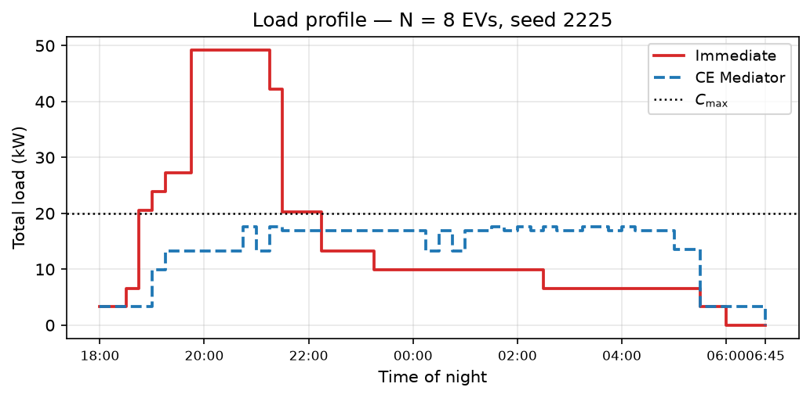
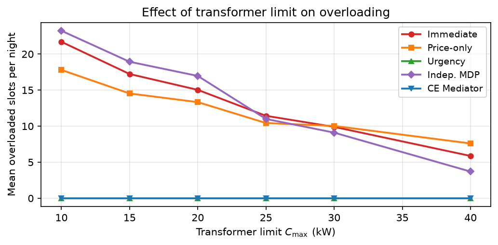
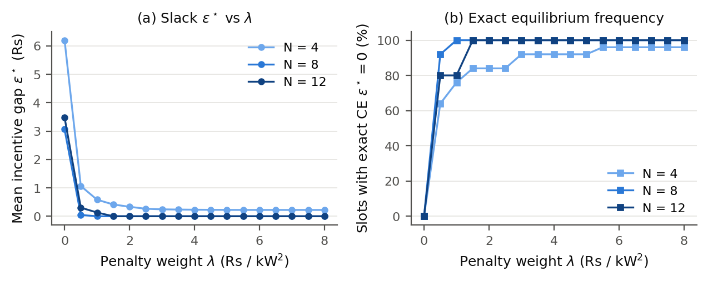
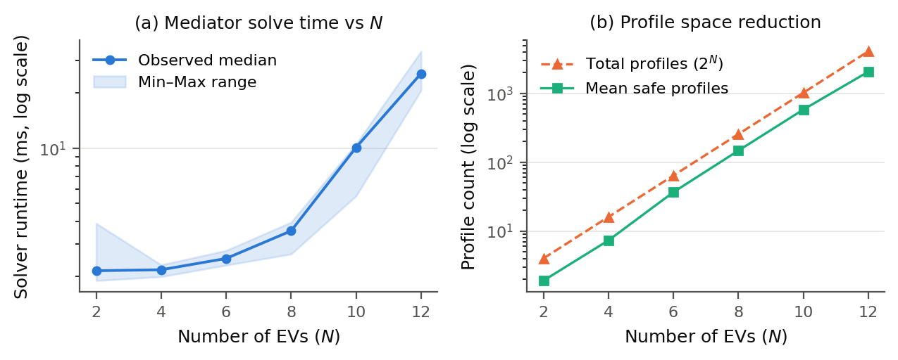
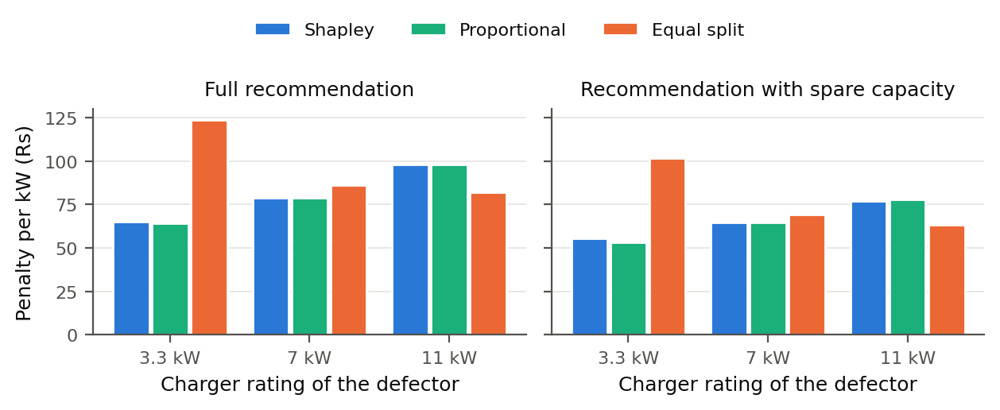
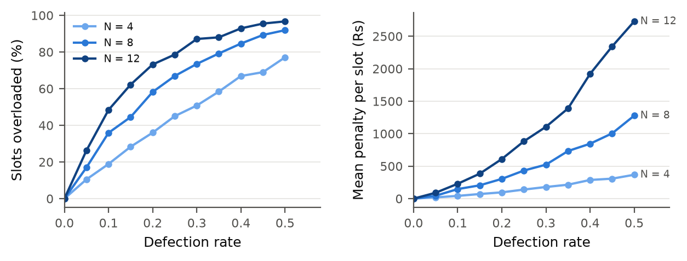

# Safe Neighbourhood EV Charging: Local Planning, a Correlated Mediator, and Shapley Penalties

**Group 25 — Foundations of AI & Multi-Agent Systems (Semester 5, 2026-27)**

Several electric vehicles (EVs) in one neighbourhood share a distribution transformer. Each EV plans its own charging with a small finite-horizon MDP, using the share of the transformer the mediator announces, and reports what charging and waiting are worth to it in every 15-minute slot. The mediator solves a three-phase linear program over the 2^N joint ON/OFF profiles of the connected EVs for a correlated recommendation that never exceeds the transformer limit. An EV that is told to wait and charges anyway pays for the overload it causes, and several such EVs share the penalty by the Shapley value.

**Report:** [report/FMAS_Group25_Final_Report.pdf](report/FMAS_Group25_Final_Report.pdf) (LaTeX source: [report/main.tex](report/main.tex)).

**Main results** (C_max = 20 kW, 30 seeds; all numbers come from `results/` and are regenerated by `run_all`):

| EVs | Mediator: overloaded slots | Mediator: EVs at target | Policies that ignore the limit: overloaded slots / EVs at target |
|---|---|---|---|
| 4 | 0 | 88% | 6 to 8 / 89 to 94% |
| 8 | 0 | 58% | 14 to 18 / 87 to 95% |
| 12 | 0 | 26% | 17 to 21 / 91 to 96% |

The Shapley split never charged a defector less than it would pay alone; an equal split did so in 12% of slots with two or more defectors.

---

## Team

| Member | Roll | Module |
|---|---|---|
| Busa Bhava Ram | 24110083 | Local EV model (`evsim/mdp.py`), scenario generator (`evsim/scenarios.py`) |
| Muppala Harshith | 24110213 | Mediator LP (`evsim/mediator.py`), lambda and runtime experiments |
| Moram Raghavendra Sri Koushik | 24110210 | Penalty module (`evsim/penalty.py`), Shapley split, penalty-rule experiments |
| Sura Sravan Kumar | 24110362 | Simulator (`evsim/sim.py`), baselines (`evsim/baselines.py`), experiment scripts, figures, README |

---

## Install

```bash
git clone https://github.com/1357koushik/safe-ev-charging-mediator
cd safe-ev-charging-mediator
python -m venv .venv
# Windows:
.venv\Scripts\activate
# macOS/Linux:
source .venv/bin/activate
pip install -r requirements.txt
```

Requires Python 3.12+. All dependencies are in `requirements.txt`.

---

## Reproduce all results

```bash
python -m experiments.run_all
```

This runs every experiment script in order, writes CSVs to `results/`, and writes all figures and LaTeX table files to `report/figures/`. Typical total run time: **about 13 minutes** on a laptop (the policy comparison and C_max sweep dominate).

To run individual parts:

```bash
# Tests
python -m pytest

# Individual experiments
python -m experiments.run_policy_comparison     # policy comparison tables, load profile
python -m experiments.run_cmax_sweep            # overload vs C_max figure
python -m experiments.run_sensitivity           # tariff, charger mix, defection table
python -m experiments.run_penalty_rules         # penalty split comparison
python -m experiments.run_defection_rate        # defection rate sweep
python -m experiments.run_mediator_lambda       # eps vs lambda figure
python -m experiments.run_mediator_runtime      # runtime vs N figure

# Figures only (after all CSVs exist)
python -m experiments.make_figures
python -m experiments.figures_penalty
python -m experiments.figures_mediator
```

---

## Figure and table map

| Report item | Script | CSV | Output |
|---|---|---|---|
| Policy comparison tables, N = 4, 8, 12 | `run_policy_comparison.py` | `results/policy_comparison.csv` | `report/figures/policy_table_N{4,8,12}.tex` |
| Load profile figure | `run_policy_comparison.py` | `results/policy_comparison.csv` | `report/figures/load_profile.pdf` |
| Overload vs C_max figure | `run_cmax_sweep.py` | `results/cmax_sweep.csv` | `report/figures/overload_vs_cmax.pdf` |
| Tariff, charger mix and defection table | `run_sensitivity.py` | `results/sensitivity.csv` | `report/figures/sensitivity_table.tex` |
| Penalty rules table | `run_penalty_rules.py` | `results/penalty_rules_summary.csv` | `report/figures/penalty_rules_table.tex` |
| Penalty per kW figure | `run_penalty_rules.py` | `results/penalty_rules_summary.csv` | `report/figures/penalty_rs_per_kw.pdf` |
| Defection rate figure | `run_defection_rate.py` | `results/defection_rate.csv` | `report/figures/defection_rate.pdf` |
| eps vs lambda figure | `run_mediator_lambda.py` | `results/mediator_lambda.csv` | `report/figures/mediator_eps_lambda.pdf` |
| Runtime vs N figure | `run_mediator_runtime.py` | `results/mediator_runtime.csv` | `report/figures/mediator_runtime.pdf` |

Every table and figure in the report is written by these scripts. The numbers quoted in the report text are read from the same CSV files. Runtimes depend on the machine; everything else is identical on every run because all randomness is seeded.

---

## Seed registry

| Seed range | Experiment |
|---|---|
| BASE\_SEED + 0 .. +5 (2025–2030) | `run_penalty_rules.py` |
| BASE\_SEED + 100 .. +132 (2125–2157) | `run_defection_rate.py` |
| BASE\_SEED + 200 .. +229 (2225–2254) | `run_policy_comparison.py` |
| BASE\_SEED + 230 .. +259 (2255–2284) | `run_cmax_sweep.py` |
| BASE\_SEED + 300 .. +305 (2325–2330) | `run_mediator_runtime.py` |
| BASE\_SEED + 400 .. +409 (2425–2434) | `run_sensitivity.py` |

`run_mediator_lambda.py` uses BASE_SEED + 200 onwards for its synthetic Q-values. That overlaps the policy-comparison seeds, but the two experiments draw different things from them, so their results are independent.

`BASE_SEED = 2025` (defined in `evsim/common.py`).

---

## Screenshots

All images are in `docs/screenshots/` and are copied from `report/figures/`, which `run_all` writes.

**Load over one night** (N = 8, C_max = 20 kW): charge-on-arrival goes far above the limit, the mediator stays under it.



**Overloaded slots against the transformer limit** (N = 8, 30 seeds).



**Incentive gap and exact equilibria against the penalty weight lambda.**



**Mediator solve time against the number of EVs.**



**Penalty per kW of charger rating under the three split rules.**



**Overload and penalty as more EVs ignore the recommendation** (synthetic slots).



---

## Repository link

<https://github.com/1357koushik/safe-ev-charging-mediator>

Submission commit tag: `v1.0-submission`
